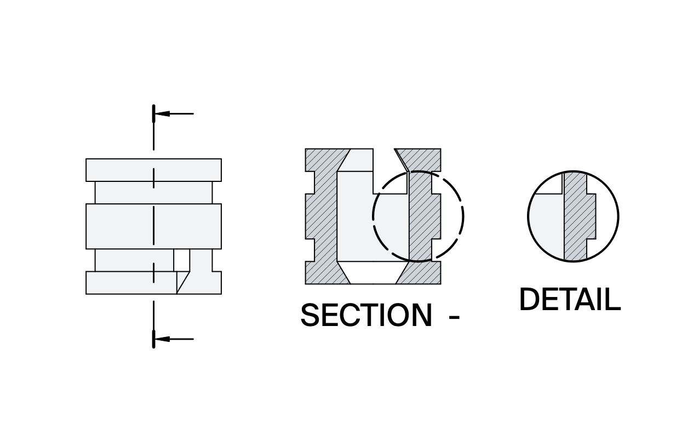

# Experimental inherited TechDraw detail hatching

This is an openly 100%-AI experiment for [FreeCAD issue #17090](https://github.com/FreeCAD/FreeCAD/issues/17090), **not an upstream pull request or an officially supported FreeCAD feature**. It demonstrates a maybe-useful implementation for developers to consider, improve, or disregard.

The implementation, tests, and this record were developed primarily using an AI coding agent, GPT-6-Astra, with human direction. Automated output checks and agent inspection of rendered exports have been performed. **Human visual verification of this new implementation was successfully completed on 20 October 2026.** See [Manual verification](#manual-verification) for the verified functionality and scope. Human verification of an earlier, deleted experiment is not evidence for this branch. Commits disclose AI assistance using the repository's `Assisted-by` convention; publication is intended as an experiment, not a claim of upstream contribution-policy acceptance.

## Starting point and baseline

- Branch: `experiment/ai-techdraw-detail-hatching` (reused, not recreated).
- Starting commit: `33adf618dcebfb167795a219175e7dbb18f7a353`.
- Initial working tree was clean; local `main` and `origin/main` pointed at that commit. The synchronized baseline supplied by the user was reused, without a reset or additional remote synchronization.
- Existing build: `build/relWithDebInfo`, Pixi default environment, configured Pixi Clang **23.1.1**, macOS Apple Silicon. No Homebrew compiler substitution, dependency changes, clean rebuild, or manual reconfiguration.
- User-provided baseline CTest result: **2,174 passing, zero failures, two skipped, eight disabled, 2,184 registered**. This is distinct from the experiment's subsequent test runs.

Issue #17090 reproduced in the existing unmodified build before production changes. The GUI harness creates a box, section, and detail, exports actual SVG and PDF files, and inspects their rendered pixels. In three fresh-process runs, inherited PAT, SVG, and solid-color fill were absent from the detail while present in the section. The retained baseline run is `build/relWithDebInfo/detail-hatch-baseline-05`.

| Display | Section red pixels SVG / PDF | Detail red pixels SVG / PDF |
|---|---:|---:|
| PatHatch | 1234 / 1328 | 0 / 0 |
| SvgHatch | 580 / 327 | 0 / 0 |
| Color | 9216 / 9216 | 0 / 0 |
| Hide | 0 / 0 | 0 / 0 |

That baseline suite ran six methods and reported six failing inheritance subtests (three modes × two formats), with zero errors. Geometry, section-fill, and hidden-fill controls passed. The same baseline scenario passes on the experimental implementation. Historical test counts from the deleted experiment are not used as validation here.

## Root cause and architecture

Section cut faces are stored separately from ordinary projected faces. `QGIViewSection` renders those regions with the section's hatch properties. A `DrawViewDetail` reconstructs its shape from the section but uses `QGIViewPart`, which previously had no inherited section-face rendering pass. Current main also contains the v26.3 face finder and void identification, which can defer section-face construction until projected faces have been found.

### Geometric association, not face-number matching

`DetailHatchGeometry` computes:

```
(union(transformed section cut faces)
 intersect union(visible detail face coverage)
 intersect detail clipping aperture)
 minus union(explicitly hatched detail faces)
```

It uses non-destructive OCC booleans and preserves partial intersections, analytic holes, overlapping coverage without duplicate fill, and disconnected pieces. Face indices are only used to identify explicit detail-hatch assignments, never to match parent faces to detail faces.

Authoritative section-cut OCC faces are retained through transformation, association, subtraction, and PAT trimming. TechDraw display geometry is created only for the final outline. It is **not** converted back into OCC for PAT trimming. Ordinary projected detail faces provide coverage masks; this is separate from authoritative cut topology. Hollow masks are excluded while retaining their selectable indices.

### Shared styles and explicit precedence

`QGIViewPart` and `QGIViewSection` use one cut-surface rendering helper for `Hide`, `Color`, `SvgHatch`, and `PatHatch`. The detail reads the parent section's live hatch scale, rotation, offset, colors, line weight, and surface transparency. Pattern spacing and line weights remain in paper coordinates; detail magnification does not automatically multiply them.

Explicit detail-face hatches replace inherited coverage across the whole selected region, including their transparent gaps. Existing explicit PAT-over-SVG precedence is retained. Removing the explicit hatch restores inheritance. Subtraction occurs before fill, SVG clipping, and PAT generation, rather than relying on drawing order or a Qt clip that PAT export does not use.

View-provider style notifications repaint dependent details. Section property handlers that return before ordinary view-provider notification also explicitly repaint them. The latter was verified by a live hide/show regression that failed before that correction and passed afterward.

### Per-detail cache and update lifecycle

The cache stores only successfully mapped/clipped OCC geometry, not styles or generated hatch strokes. The accepted source identity, source face scale/rotation, and detail crop parameters are captured with the geometry update. Normal model/placement/scale/rotation recomputations invalidate the cache. Coverage identity, Hollow assignments, explicit-hatch assignments, matting visibility, and clipping style are checked as well. Style-only paints reuse the geometry.

Details defer accepted recomputation until the parent section's cut/HLR/face work has completed. Authorization for a redraw on a page with `KeepUpdated=false` survives this wait and lasts through centerline/dimension finalization. Removed sources cancel pending work. The detail worker and mapping use the same parameter snapshot; automatic detail scaling is postponed until finalization rather than starting a generic part-projection pass mid-update.

Failed/incomplete crops do not publish inherited coverage. A small face-extraction completion flag prevents caching failures as successful empty coverage; it is not a comprehensive validity certificate for every pre-existing face-finder warning. Empty section completion now also clears obsolete ordinary projected geometry and bounds. A focused regression failed three assertions before that cleanup and passes afterward.

### Selection

Inherited hatch overlays remain decorative, separate from the ordinary selectable detail faces. Negative-index `QGIFace` items reject interaction, and right-press selection walks past decorative faces to the owning view rather than emitting `Face-1`. This intentionally does not redesign hit testing to select a hidden underlying face on right-click. Ordinary left-click/hover selection continues to use real projected faces.

## Build and run

Run from the repository root using the already configured Pixi environment:

```sh
pixi run --frozen cmake --build build/relWithDebInfo \
  --target TechDraw TechDrawGui TechDraw_tests_run -j 6

pixi run --frozen ctest --test-dir build/relWithDebInfo \
  -R 'DetailHatch|DrawViewDetailHatching|TestLineFormat' --output-on-failure

# Also exercise all TechDraw C++ tests together in one process:
pixi run --frozen build/relWithDebInfo/tests/TechDraw_tests_run
```

The new CMake source/test entries cause normal regeneration within the existing build. They do not require a clean build or changing the configured compiler.

The GUI harness runs directly from source, so it does not need installation or copying into the build's Python modules. It requires Qt 6/PySide6, a usable desktop/WindowServer, and Poppler's `pdftoppm` on PATH (or `--pdftoppm` with its executable path). Poppler was already available; no environment changes were made. Each scenario gets a separate bounded process and private preferences. Output directories must be new to prevent stale-artifact false positives.

```sh
pixi run --frozen --environment default python \
  src/Mod/TechDraw/TDTest/DrawViewDetailHatchGuiTest.py --list-cases

# Quick original-issue regression; expected to pass:
pixi run --frozen --environment default python \
  src/Mod/TechDraw/TDTest/DrawViewDetailHatchGuiTest.py \
  --freecad build/relWithDebInfo/bin/FreeCAD \
  --output-dir build/relWithDebInfo/detail-hatch-check-01 \
  --case baseline --timeout 120

# Full strict suite; currently exits 1 for the known exporter limitation below:
pixi run --frozen --environment default python \
  src/Mod/TechDraw/TDTest/DrawViewDetailHatchGuiTest.py \
  --freecad build/relWithDebInfo/bin/FreeCAD \
  --output-dir build/relWithDebInfo/detail-hatch-check-all-01 \
  --case all --timeout 120
```

Repeat `--case` to select scenarios. `--dry-run` shows the plan without launching FreeCAD. The launcher returns 0 for passing assertions, 1 for assertion failures, 2 for setup/export/process errors, and 124 for timeout. It saves runtime hashes, per-method/subtest results, SVG/PDF exports, and rendered images.

The existing `TestTechDrawApp` and `TestTechDrawGui` modules can also be run using FreeCAD's Test framework. Both were executed, regardless of their App/Gui naming. To invoke them in a running built GUI's Python console:

```python
import unittest
suite = unittest.defaultTestLoader.loadTestsFromNames(
    ["TestTechDrawApp", "TestTechDrawGui"])
result = unittest.TextTestRunner(verbosity=2).run(suite)
```

## Actual validation results

Final targeted production build: **successful**, log `build/relWithDebInfo/detail-hatch-build-06.log`. Final runtime: FreeCAD reported **27.1.0 / Dev Build**, Python **3.13.15**, Qt **6.11.2**, Poppler **26.08.0**. Validation date: **2026-10-20**, local CEST. The runtime metadata records actual loaded-module hashes rather than relying on the executable's generic version string.

| Validation | Result |
|---|---|
| Focused CTest | **41/41 passed**, 12.23 s; 39 new tests plus 2 existing LineFormat tests |
| All TechDraw C++ tests in one process | **41/41 passed** |
| Existing `TestTechDrawApp` | **11 methods and 46 subtests passed** |
| Existing `TestTechDrawGui` | **12 methods passed** |
| New GUI suite, 11 isolated scenarios | **16/17 methods, 400/408 subtests passed**; only the 8 known SVG-export assertions fail |
| Original-issue GUI scenario | **6/6 methods, 32/32 subtests passed** |
| Real hover/left/right selection | **2/2 methods, 17/17 subtests passed**, no `Face-1` |
| Actual exported files | **44/44 PDFs and 44/44 SVGs** opened/parsed and rendered |

The final GUI suite and existing Python suites had **zero errors, skips, or timeouts**. PDF inspection confirmed one page per export, 567 × 340 pt, rotation 0, unencrypted. All exported pages were rendered for pixel assertions; representative images were visually inspected by the agent. `qpdf` was unavailable, so this is not a comprehensive PDF structural-integrity or archival-conformance claim.

The C++ tests cover geometric association/order independence, exact clipping, overlapping regions, circular/thin elliptical holes, PAT segments not crossing holes, explicit subtraction/restoration, cache keys, accepted-frame snapshots, frozen-page deferral/cancellation, actual headless document updates, and centerline-before-dimension finalization. GUI cases cover live styles before export, precedence/removal, holes/clipping, geometry/anchor/scales, parent/detail rotations with off-center holes, frozen updates, ordinary section controls, and actual mouse selection.

### Broader CTest attempt — incomplete, not green

The command below was bounded externally to 600 seconds:

```sh
pixi run --frozen ctest --test-dir build/relWithDebInfo --output-on-failure -j 6
```

It timed out after **2,211 passed, two skipped, eight disabled, and zero completed failures**. The sole started-but-unfinished test was `CrashReporterTests.realCrashCapturesUsableFrames`. That run registered 2,222 tests and preceded the last empty-section regression; the final tree registers one additional test. No longer-timeout retry or unrelated CrashReporter changes were made. This is **not** a successful complete baseline-suite rerun.

### Retained evidence

All paths below are under ignored `build/relWithDebInfo/`, not committed build artifacts:

- `detail-hatch-baseline-05/`: unmodified-build reproduction and export evidence.
- `detail-hatch-ctest-final.log`: final 41-test CTest result.
- `detail-hatch-single-process-final.log`: final shared-process C++ result and cache timing.
- `detail-hatch-ctest-all-01.log`: incomplete broader CTest run.
- `detail-hatch-final06-01/validation-summary.json`: final GUI counts, commands, timestamps, and binary/script hashes.
- `detail-hatch-final06-01/pdf-inspection.json`: export inspection and comparison with prior rendered output.
- `techdraw-final06-unittest-01/`: final existing Python-suite results and exact isolated launch recipe.
- `detail-hatch-rebuild04-final-03/style-color/`: live repaint regression before its fix.
- `detail-hatch-empty-section-01.log`: empty-section regression before its fix.

## Manual verification

On **20 October 2026**, the contributor manually launched and tested the locally built FreeCAD application and confirmed that a Detail View created from a hatched Section View now displays the previously missing inherited section hatching correctly in the tested drawing. This confirms the primary user-visible functionality and resolves the original visible problem described in issue #17090 for that drawing. It does **not** establish that every rendering mode, export scenario, or edge case has been manually verified; the broader checks below remain instructions, not a record that all were performed.

### Open the generated reproducible example

After running the quick GUI scenario, open its `reproducer.FCStd` with the built FreeCAD. The final local validation fixture can be opened directly:

```sh
pixi run --frozen build/relWithDebInfo/bin/FreeCAD \
  build/relWithDebInfo/detail-hatch-final06-01/baseline/reproducer.FCStd
```

1. Open `Page`. The middle section and right circular detail should both have red PAT hatching. The detail has **no explicit hatch object**.
2. Select `Section`. Switch `CutSurfaceDisplay` through `Hide`, `Color`, `SvgHatch`, and `PatHatch`. Both views should update live, without requiring export.
3. Change hatch scale, rotation, offset, colors, PAT weight, and cut-surface transparency. The detail should inherit those settings.
4. Apply an explicit SVG or PAT hatch to a real detail face. Its entire region should replace inherited styling. Delete that hatch; inheritance should return.
5. Move the detail anchor or change radius/scale; verify the hatching follows the clipped geometry. The `holes-clipping` and `transforms` scenario fixtures provide hole and rotated-square examples.
6. Freeze the page with `KeepUpdated=false`, modify geometry, then issue the page redraw command. Verify final geometry, inherited hatching, dimensions, and centerlines after asynchronous work settles.
7. Left-click/hover a face and right-click a decorative hatch region. No `Face-1` should appear in selection. Right-clicking decoration may select its owning view.
8. Export SVG and PDF and inspect the actual files. Use PAT if exported hatch rotation/offset is required; see the limitation below.

### Recreate the original problem from scratch

Create a solid box (or a bored solid), insert a TechDraw page and ordinary view, and make a Section View whose plane crosses the solid. Enable a section cut-surface hatch. Select that Section View and create a Detail View centered on a hatched cut region at increased scale. The starting build loses the hatch in the detail; this branch inherits it without adding a separate hatch object. A detail of an ordinary non-section view should not gain section hatching.

## Known limitations and performance

- **Pre-existing SVG-pattern export defect:** live hatch rotation/offset works, but SVG/PDF export loses it for both ordinary sections and details. `QGIFace::buildPixHatch()` loads an untransformed pixmap; its rotation/offset transform is commented out. The relevant exporter functions were byte-identical to the starting commit. This is source-confirmed pre-existing behavior, **not historical runtime proof**, because the baseline exports used default rotation/offset. The eight strict assertions remain failing, not skipped or marked expected failures. Fixing the shared exporter is outside this experiment.
- **Incomplete broad CTest run:** the CrashReporter test above did not finish within the 600-second budget. It was not investigated as part of inherited hatching.
- **Bounded scope:** direct section → detail inheritance with face extraction is tested. Nested detail inheritance is not added. Aligned complex sections have a local scale-convention adjustment, but a real aligned-complex fixture is unverified. Perspective/coarse views, exhaustive legacy face-finder combinations, automatic-scale extremes, arbitrary malformed solids, and every export backend are not certified by these tests.
- **Conservative failure policy:** an unsuccessful component crop rejects inherited coverage instead of caching a partial result. This also affects ordinary detail crop failure handling. Existing recovery behavior outside the tested cases is not comprehensively redesigned.
- **GUI isolation:** the final 11 scenarios pass or fail assertions normally in separate GUI processes; they do not establish reliability of sequential export scenarios in one GUI process. One disposable diagnostic process stalled at its 240-second limit (`detail-hatch-rebuild04-investigate-03/timeout.json`); it is not counted as a passing run. The final suites themselves had no timeouts. Both existing Python suites and all C++ tests also passed their respective shared-process runs.
- **Measured geometry-cache cost:** the final synthetic test has 100 section faces and 100 overlapping coverage faces, verifies 400 mm² without duplicate fill, and checks OCC identity across 100 cached reads with ten style changes. The first getter took **109.587 ms**; all 100 cached getters together took **0.612291 ms** on this machine. Timings exclude fixture construction/assertions and are informational, not enforced thresholds. They do not benchmark the same geometry as the deleted experiment's 2.2-second example.
- **Cache boundary:** PAT line generation and SVG rendering are still performed during drawing. The cache only avoids repeated geometry association/clipping booleans. There is no global cache or new persistence format.
- **Human verification scope:** the successful contributor check described under [Manual verification](#manual-verification) confirms the primary user-visible functionality in the tested drawing, not exhaustive manual coverage of rendering modes, exports, or edge cases. The automated results and other documented limitations remain unchanged.

## Changed-file guide and publication status

The following 22 files comprise the experiment:

| Area | Files |
|---|---|
| Documentation | `EXPERIMENT_DETAIL_HATCHING.md` |
| OCC mapping | `src/Mod/TechDraw/App/DetailHatchGeometry.cpp`, `src/Mod/TechDraw/App/DetailHatchGeometry.h` |
| App integration | `src/Mod/TechDraw/App/DrawViewDetail.cpp`, `src/Mod/TechDraw/App/DrawViewDetail.h`, `src/Mod/TechDraw/App/DrawViewSection.cpp`, `src/Mod/TechDraw/App/DrawViewSection.h` |
| Completion gate / detail autoscale boundary | `src/Mod/TechDraw/App/DrawViewPart.cpp`, `src/Mod/TechDraw/App/DrawViewPart.h` |
| Shared rendering | `src/Mod/TechDraw/Gui/QGIViewPart.cpp`, `src/Mod/TechDraw/Gui/QGIViewPart.h`, `src/Mod/TechDraw/Gui/QGIViewSection.cpp` |
| Style updates | `src/Mod/TechDraw/Gui/ViewProviderViewSection.cpp`, `src/Mod/TechDraw/Gui/ViewProviderViewSection.h` |
| Decorative selection | `src/Mod/TechDraw/Gui/QGIFace.cpp`, `src/Mod/TechDraw/Gui/MDIViewPage.cpp` |
| C++ regressions | `tests/src/Mod/TechDraw/App/DetailHatchGeometry.cpp`, `tests/src/Mod/TechDraw/App/DrawViewDetailHatching.cpp` |
| GUI/export regressions | `src/Mod/TechDraw/TDTest/DrawViewDetailHatchGuiTest.py`, `src/Mod/TechDraw/TDTest/DrawViewDetailHatchGuiCases.py` |
| Build/test registration | `src/Mod/TechDraw/App/CMakeLists.txt`, `tests/src/Mod/TechDraw/App/CMakeLists.txt` |

The implementation, tests, and documentation are preserved in local checkpoints, including the baseline reproduction (`d3fe338a7a`) and main implementation (`59df330aae`), followed by final corrections/results. Use `git log` for the final checkpoint hash and `git diff 33adf618dcebfb167795a219175e7dbb18f7a353 --stat` for the complete change set. No build outputs, private GUI preferences, machine-specific configuration, or unrelated submodule changes are intended for publication.
